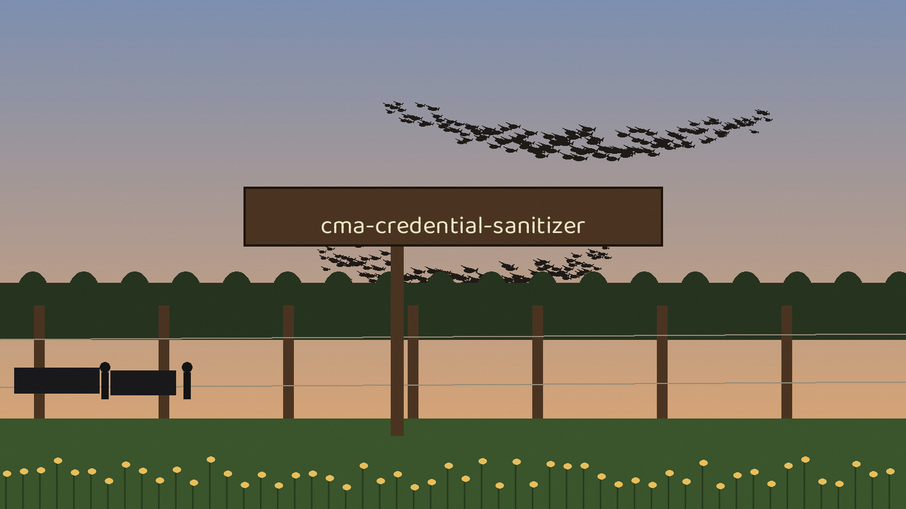

# cma-Credential-Sanitizer
Removes secrets from command history files (bash, zsh, powershell) and Jupyter Notebooks. Identifies and redacts API keys, passwords, and other credentials using regular expressions. In Jupyter Notebooks it redacts code cell sources, markdown cell sources, and code cell outputs. No backup is written by default. With `--backup` it writes a timestamped .bak copy of each original file first, with owner only permissions (0600): that backup contains the removed secrets in clear text and must be handled as credential material. Passing `--directory` without `--filetype jupyter` is rejected with exit 1, because the directory search only applies to notebooks. Uses `os` for file system access, `re` for regex, and `shutil` for backups when `--backup` is given.

## Install
`git clone https://github.com/ShadowGuardAI/cma-credential-sanitizer`

## Usage
`./cma-credential-sanitizer [params]`

## Parameters
- `-h`: Show help message and exit
- `--filetype`: No description provided
- `--filepath`: The specific file path to sanitize.  Overrides --filetype if provided.
- `--directory`: No description provided
- `--all`: No description provided
- `--regex_file`: No description provided
- `--backup`: Write a timestamped .bak copy of each original file before sanitizing, with owner only permissions (0600). Off by default. A backup contains the removed secrets in clear text and must be handled as credential material.

## License
Copyright (c) ShadowGuardAI
